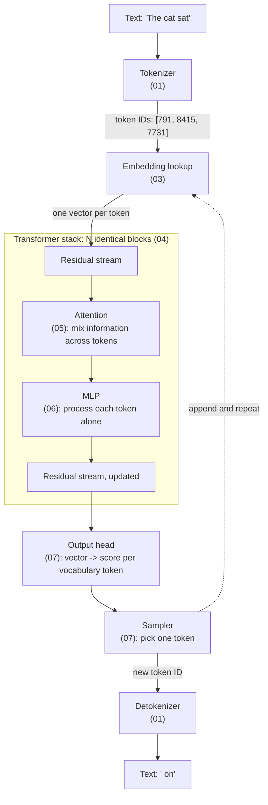

# 00 — The Big Picture

**Scope:** the parts of an LLM and the path of one request through them.
**Next:** [01 Tokenizer](01-tokenizer.md). **Index:** [README](README.md).

## An LLM is two artifacts

A deployed LLM has two parts ([Karpathy, *Intro to LLMs*](https://www.youtube.com/watch?v=zjkBMFhNj_g)):

1. **The weights file.** This is data. It holds billions of numbers that training produced. Llama 2 70B stores 70 billion parameters at 2 bytes each, so its weights take about 140 GB.
2. **The runtime.** This is code. It reads the weights and executes a fixed dataflow graph over them. Karpathy notes that a minimal runtime for Llama 2 fits in about 500 lines of C.

The weights hold all the "knowledge". The runtime holds no knowledge. It only knows the shape of the graph and the order of the operations.

## The model is a pure function

At its core, the model is a function with no memory between calls:

```
f(weights, list of token IDs) -> probability for each token in the vocabulary
```

The function predicts **one** next token. To produce a reply, the runtime calls the function in a loop. It appends each new token to the input and calls the function again. This loop is "autoregressive generation".

Two consequences for system design:

- **The conversation is the state.** The model does not remember the previous request. The client sends the full conversation every time, or the server caches it. See [08 Inference runtime](08-inference-runtime.md).
- **The cost grows with output length.** Each output token needs one more pass through the model.

## The request path



The token IDs in the diagram are examples only. Each tokenizer assigns its own IDs.

## Component map

| Component | Input | Output | Learned weights? | State across calls? | Document |
|-----------|-------|--------|------------------|---------------------|----------|
| Tokenizer | text | token IDs | merge rules, not neural weights | no | [01](01-tokenizer.md) |
| Embedding table | token IDs | one vector per token | yes | no | [03](03-embeddings-and-positions.md) |
| Position encoding | token positions | rotation applied in attention | usually no (RoPE) | no | [03](03-embeddings-and-positions.md) |
| Attention layer | all token vectors | an update for each vector | yes | KV cache | [05](05-attention.md) |
| MLP layer | one token vector | an update for that vector | yes | no | [06](06-mlp-and-neurons.md) |
| Normalization | a vector | the same vector, rescaled | small scale vector | no | [04](04-transformer-block.md) |
| Output head | last token vector | one score (logit) per vocabulary entry | yes | no | [07](07-output-and-sampling.md) |
| Sampler | logits | one token ID | no | random seed | [07](07-output-and-sampling.md) |

## Decoder-only design

The original transformer ([Vaswani et al., 2017](https://arxiv.org/abs/1706.03762)) had two stacks: an encoder that read the source sentence and a decoder that wrote the translation.
Modern chat LLMs keep only the decoder stack. Each token can look only at itself and at earlier tokens. This "causal" rule lets one model both read a prompt and continue it.

## Five numbers that describe a model

Most architecture decisions reduce to a few configuration values. Llama 3 8B is an example ([Llama 3 paper, Table 3](https://arxiv.org/abs/2407.21783)):

| Setting | Meaning | Llama 3 8B |
|---------|---------|------------|
| Layers | Number of transformer blocks in the stack | 32 |
| Model dimension | Length of each token vector in the residual stream | 4,096 |
| Attention heads | Parallel attention units in each layer | 32 query heads, 8 key/value heads |
| MLP width | Number of neurons in each MLP layer | 14,336 |
| Vocabulary size | Number of distinct tokens | about 128,000 |

[02 Tensors and weights](02-tensors-and-weights.md) shows how these values give the parameter count and the memory size.

## Sources

- Vaswani et al., *Attention Is All You Need*, NeurIPS 2017 — https://arxiv.org/abs/1706.03762
- Karpathy, *Intro to Large Language Models* (talk, 2023) — https://www.youtube.com/watch?v=zjkBMFhNj_g
- Llama Team, *The Llama 3 Herd of Models*, 2024 — https://arxiv.org/abs/2407.21783
- Alammar, *The Illustrated GPT-2* — https://jalammar.github.io/illustrated-gpt2/
