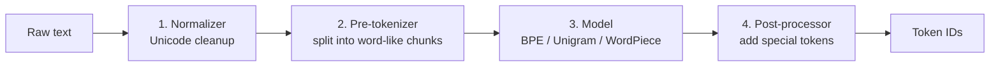

# 01 — Tokenizer

**Scope:** how text becomes token IDs, and how token IDs become text again.
**Previous:** [00 Big picture](00-big-picture.md). **Next:** [02 Tensors and weights](02-tensors-and-weights.md).

## Role in the system

The neural network operates on integers, not on text. The tokenizer is the adapter between the two.
It is a separate component with its own training data, its own training algorithm, and its own file ([Karpathy, minbpe](https://github.com/karpathy/minbpe)).
After training, it exposes two functions:

- `encode(text) -> list of token IDs`
- `decode(list of token IDs) -> text`

The tokenizer has no neural weights. It is a deterministic program plus a table of rules.

## The tokenizer pipeline

The Hugging Face `tokenizers` library splits the work into four stages ([HF tokenizers docs, "The tokenization pipeline"](https://huggingface.co/docs/tokenizers/pipeline)):

1. **Normalizer.** It applies Unicode normalization and other cleanup. If you change this stage, you must retrain the tokenizer.
2. **Pre-tokenizer.** It splits the text into chunks, for example at spaces or with a regex. A final token never crosses a chunk boundary. GPT-2 and GPT-4 use a regex that keeps letters, numbers, and punctuation apart ([minbpe](https://github.com/karpathy/minbpe)).
3. **Model.** It converts each chunk into one or more vocabulary entries. Byte-Pair Encoding (BPE) is the most common algorithm in LLMs.
4. **Post-processor.** It adds the special tokens that the model expects, for example a begin-of-sequence token.

## Byte-Pair Encoding (BPE)

[Sennrich et al. (2016)](https://arxiv.org/abs/1508.07909) adapted BPE, a compression algorithm, to split rare words into known subword units.

**Training** (one time, offline):

1. Start with a base vocabulary. Byte-level BPE uses the 256 possible byte values, so every input is encodable.
2. Count every adjacent pair of tokens in the training text.
3. Merge the most frequent pair into a new token. Record the merge rule.
4. Repeat until the vocabulary reaches the target size.

**Encoding** (every request): apply the recorded merge rules, in the same order, to the input bytes.

The output of training is two tables: the **vocabulary** (token ID to byte string) and the **merge list** (the ordered rules).

## Vocabulary size is an architecture decision

The vocabulary size sets the shape of two weight matrices: the embedding table and the output head (see [03](03-embeddings-and-positions.md) and [07](07-output-and-sampling.md)).

| Model | Tokenizer | Vocabulary size |
|-------|-----------|-----------------|
| GPT-2 | byte-level BPE | 50,257 |
| Llama 2 | SentencePiece BPE | 32,000 |
| Llama 3 | tiktoken-based byte-level BPE | about 128,000 |

The trade-off:

- **A larger vocabulary** packs more text into each token. Llama 3 raised English compression from 3.17 to 3.94 characters per token over Llama 2 ([Llama 3 paper](https://arxiv.org/abs/2407.21783)). Fewer tokens mean less compute and a longer effective context.
- **A larger vocabulary also costs memory.** The embedding table and output head grow in direct proportion. Cloudflare notes that these two layers in Llama 3 are about four times bigger than in Llama 2 ([Cloudflare blog](https://blog.cloudflare.com/meta-llama-3-available-on-cloudflare-workers-ai/)).

## SentencePiece

[SentencePiece (Kudo and Richardson, 2018)](https://arxiv.org/abs/1808.06226) trains directly on raw sentences. It does not need text that is already split into words, so it works for languages without spaces. It treats the space as a normal symbol and keeps it inside tokens. Llama 1 and Llama 2 use it.

## Special tokens and chat templates

Special tokens are vocabulary entries with a control meaning. Examples: begin-of-sequence, end-of-sequence, and role markers such as `[INST]`.
The model learns their meaning in training. The runtime uses them as signals, for example "stop at end-of-sequence".

A **chat template** converts a list of chat messages into one token sequence. Hugging Face stores the template as a Jinja string in `tokenizer_config.json` ([HF chat templates docs](https://huggingface.co/docs/transformers/main/chat_templating)).
The template must match the format that the model saw in fine-tuning. A wrong template degrades the output quality without an error.

**Security note:** special tokens must not come from user text. If the encoder converts user text such as `<|endoftext|>` into the real control token, a user can inject control signals. minbpe makes the caller allow special tokens explicitly for this reason ([minbpe README](https://github.com/karpathy/minbpe)).

## Detokenization in a streaming server

Byte-level tokens do not always end on a character boundary. One emoji can span several tokens.
A streaming server must hold back incomplete UTF-8 bytes until the next token completes the character. Otherwise the client receives invalid characters.

## Tokenization explains many model quirks

Karpathy argues that many odd LLM behaviors come from tokenization ([*Let's build the GPT Tokenizer*](https://www.youtube.com/watch?v=zduSFxRajkE)). Examples:

- The model sees "strawberry" as one or a few tokens, not as letters. So letter-count tasks are hard.
- Numbers split into irregular chunks. This makes arithmetic harder.
- Non-English text often needs more tokens for the same content. So it costs more and fills the context window faster.

## Sources

- Sennrich, Haddow, Birch, *Neural Machine Translation of Rare Words with Subword Units*, ACL 2016 — https://arxiv.org/abs/1508.07909
- Kudo and Richardson, *SentencePiece*, EMNLP 2018 — https://arxiv.org/abs/1808.06226
- Karpathy, *minbpe* repository — https://github.com/karpathy/minbpe
- Karpathy, *Let's build the GPT Tokenizer* (video, 2024) — https://www.youtube.com/watch?v=zduSFxRajkE
- Hugging Face, *Tokenizers: the tokenization pipeline* — https://huggingface.co/docs/tokenizers/pipeline
- Hugging Face, *LLM Course, chapter 6: Byte-Pair Encoding tokenization* — https://huggingface.co/learn/llm-course/chapter6/5
- Hugging Face, *Chat templates* — https://huggingface.co/docs/transformers/main/chat_templating
- Llama Team, *The Llama 3 Herd of Models*, 2024 — https://arxiv.org/abs/2407.21783
