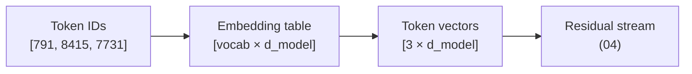

# 03 — Embeddings and Positions

**Scope:** how a token ID becomes a vector, and how the model knows the order of tokens.
**Previous:** [02 Tensors and weights](02-tensors-and-weights.md). **Next:** [04 Transformer block](04-transformer-block.md).

## The embedding table

The embedding table is a weight matrix with one row for each vocabulary entry.
Its shape is `[vocabulary size, model dimension]`. For Llama 2 7B, the shape is `[32,000, 4,096]`.

The operation is a table lookup:

```
token ID 8415  ->  row 8415 of the table  ->  a vector of 4,096 numbers
```

The lookup is cheap. It reads one row per token and does no arithmetic. But the table is large, because it has one row for each vocabulary entry (see [01](01-tokenizer.md)).



## What the vector means

Training sets the numbers in each row. Nobody designs them by hand.
After training, directions in the vector space tend to correspond to properties. Tokens with related meaning get nearby vectors. 3Blue1Brown shows this with examples such as a "gender" direction ([*But what is a GPT?*, chapter 5](https://www.3blue1brown.com/topics/neural-networks)).

The embedding vector is only the starting point. Each block of the stack adds information to it, so the vector for "bank" soon carries different content in "river bank" and in "bank account". See [04](04-transformer-block.md).

## Shared input and output tables

Some models use the same matrix for the embedding table and for the output head ([07](07-output-and-sampling.md)). This is "weight tying". GPT-2 ties the two matrices. Llama 2 does not.
Tying saves one `[vocabulary × model dimension]` matrix. For a model with a large vocabulary, this saving is significant.

## Why the model needs position information

The attention operation ([05](05-attention.md)) treats its input as a set. Without extra information, "dog bites man" and "man bites dog" produce the same attention result.
So every design adds position information. The designs differ in **where** they add it.

| Method | Where it acts | Used by | Context limit |
|--------|---------------|---------|---------------|
| Sinusoidal absolute | A fixed vector added to each token vector at the input | Original transformer ([Vaswani et al., 2017](https://arxiv.org/abs/1706.03762)) | Soft |
| Learned absolute | A learned vector per position, added at the input | GPT-2 | Hard: one row per position, so no input beyond the table size |
| **RoPE** (rotary) | A rotation applied to queries and keys inside **every** attention layer | Llama 2, Llama 3, Mistral, many others | Soft; the runtime can stretch it |
| ALiBi | A distance penalty added to attention scores | BLOOM | Soft |

## RoPE in system terms

RoPE comes from [Su et al. (2021), RoFormer](https://arxiv.org/abs/2104.09864). It rotates each query vector and each key vector by an angle that depends on the token's position. Different pairs of dimensions rotate at different speeds.

When attention compares a query with a key, the two rotations partly cancel. The result depends on the **distance** between the two tokens, not on their absolute positions.

System consequences:

- **RoPE has no weights.** It is a fixed function of the position. Nothing extra goes in the weights file, except a few settings in `config.json`, such as the base frequency.
- **RoPE acts on the query and key vectors only.** It does not change the value vectors or the residual stream ([Llama 2 paper](https://arxiv.org/abs/2307.09288)).
- **The cache stores rotated keys.** The KV cache ([08](08-inference-runtime.md)) holds keys after the rotation, so the runtime does not rotate them again.
- **The context window can grow after training.** Methods such as position interpolation ([Chen et al., 2023](https://arxiv.org/abs/2306.15595)) rescale the positions so a model can accept longer inputs than in training. Quality outside the trained length is not guaranteed.

## Sources

- Vaswani et al., *Attention Is All You Need*, 2017 — https://arxiv.org/abs/1706.03762
- Su et al., *RoFormer: Enhanced Transformer with Rotary Position Embedding*, 2021 — https://arxiv.org/abs/2104.09864
- Press, Smith, Lewis, *Train Short, Test Long: Attention with Linear Biases (ALiBi)*, ICLR 2022 — https://arxiv.org/abs/2108.12409
- Chen et al., *Extending Context Window of Large Language Models via Positional Interpolation*, 2023 — https://arxiv.org/abs/2306.15595
- Touvron et al., *Llama 2*, 2023 — https://arxiv.org/abs/2307.09288
- 3Blue1Brown, *But what is a GPT? Visual intro to transformers* (Deep Learning, chapter 5) — https://www.3blue1brown.com/topics/neural-networks
