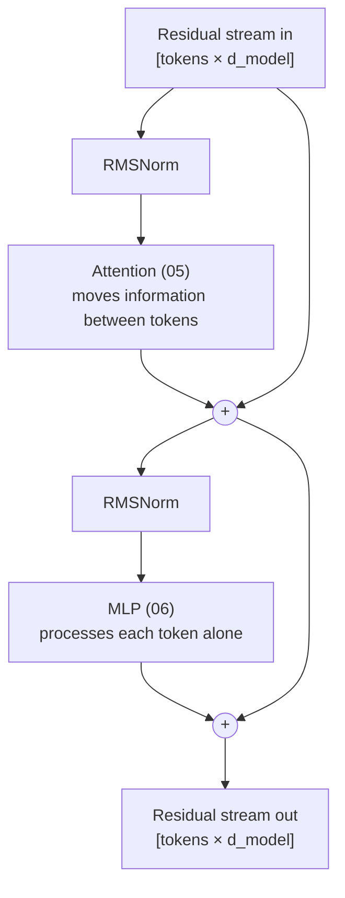

# 04 — Transformer Block and Residual Stream

**Scope:** the repeated unit of an LLM, and the shared channel that its parts use to communicate.
**Previous:** [03 Embeddings and positions](03-embeddings-and-positions.md). **Next:** [05 Attention](05-attention.md).

## The stack

An LLM is a stack of identical **blocks** (also called layers). Llama 3 8B has 32 blocks. Llama 3 70B has 80 ([Llama 3 paper](https://arxiv.org/abs/2407.21783)).
All blocks have the same structure but different weights. Each block reads a tensor of shape `[tokens, model dimension]` and writes a tensor of the same shape.

This fixed interface has system benefits:

- The runtime can run the blocks in a simple loop.
- A pipeline-parallel runtime can put different blocks on different GPUs ([09](09-scaling-across-devices.md)).
- The blocks run in strict sequence. So the latency of one forward pass grows with the number of blocks.

## Inside one block

Modern decoder-only models use the "pre-norm" layout. Llama 2 uses pre-normalization with RMSNorm, a SwiGLU MLP, and RoPE ([Llama 2 paper](https://arxiv.org/abs/2307.09288)).

The block has two sub-layers. Each sub-layer reads a normalized copy of the stream, computes an update, and **adds** the update back to the stream.

| Sub-layer | Works across tokens? | Job |
|-----------|----------------------|-----|
| Attention | Yes | Copies information from earlier tokens into the current token. |
| MLP | No, one token at a time | Transforms the information that is already in the token's vector. |

This is the central division of labor in a transformer: **attention moves information, the MLP processes it.**

## The residual stream is a shared bus

[Elhage et al. (2021)](https://transformer-circuits.pub/2021/framework/index.html) describe the residual stream as a communication channel:

- The stream does no processing itself.
- Each attention layer and each MLP layer **reads** from the stream with a linear projection.
- Each layer **writes** its result back by **adding** a linear projection to the stream.
- So a later layer can read what any earlier layer wrote. Layers communicate only through the stream.

A system analogy: the residual stream is a shared memory bus, or a blackboard. Every component reads the blackboard and adds notes to it. No component erases the blackboard. The stream width (the model dimension) is the bandwidth of the bus.

Two consequences:

1. **Each layer is a small, additive change.** The final vector is the sum of the original embedding and every layer's contribution. Interpretability research uses this property to trace which component contributed what. See [13](13-interpretability.md).
2. **The bus is crowded.** Many layers write many kinds of information into the same fixed-width vector. Models pack more "features" than dimensions into it. This is "superposition". See [13](13-interpretability.md).

## Normalization

A normalization layer rescales a vector to a standard size. It keeps the numbers in a stable range, so training does not diverge.

- **LayerNorm** subtracts the mean and divides by the standard deviation. Then it applies a learned scale and shift.
- **RMSNorm** ([Zhang and Sennrich, 2019](https://arxiv.org/abs/1910.07467)) skips the mean step and the shift. It is cheaper, and Llama, Mistral, and many others use it.
- **Pre-norm** puts the norm before each sub-layer, inside the branch. The stream itself stays un-normalized. Pre-norm makes deep stacks easier to train ([Xiong et al., 2020](https://arxiv.org/abs/2002.04745)).

A final norm runs after the last block and before the output head ([07](07-output-and-sampling.md)).

## What changes with depth

Research finds a rough progression through the stack:

- **Early layers** respond to surface patterns, such as specific words or n-grams ([Geva et al., 2021](https://aclanthology.org/2021.emnlp-main.446)).
- **Middle layers** hold more abstract features. Anthropic trained its large sparse autoencoders on a middle layer of Claude 3 Sonnet for this reason ([Templeton et al., 2024](https://transformer-circuits.pub/2024/scaling-monosemanticity/index.html)).
- **Late layers** focus on the prediction of the next token ([Geva et al., 2021](https://aclanthology.org/2021.emnlp-main.446)).

These are tendencies, not strict rules.

## Sources

- Elhage et al., *A Mathematical Framework for Transformer Circuits*, Anthropic, 2021 — https://transformer-circuits.pub/2021/framework/index.html
- Touvron et al., *Llama 2*, 2023 — https://arxiv.org/abs/2307.09288
- Llama Team, *The Llama 3 Herd of Models*, 2024 — https://arxiv.org/abs/2407.21783
- Zhang and Sennrich, *Root Mean Square Layer Normalization*, NeurIPS 2019 — https://arxiv.org/abs/1910.07467
- Xiong et al., *On Layer Normalization in the Transformer Architecture*, ICML 2020 — https://arxiv.org/abs/2002.04745
- Geva et al., *Transformer Feed-Forward Layers Are Key-Value Memories*, EMNLP 2021 — https://aclanthology.org/2021.emnlp-main.446
- Templeton et al., *Scaling Monosemanticity*, Anthropic, 2024 — https://transformer-circuits.pub/2024/scaling-monosemanticity/index.html
