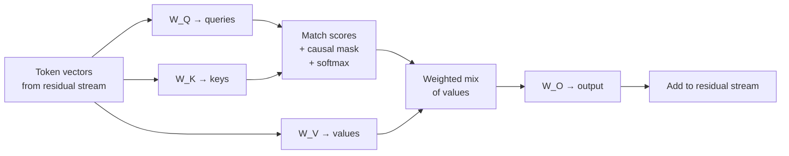

# 05 — Attention

**Scope:** how one token gets information from other tokens, the role of attention heads, and the variants that shrink the KV cache.
**Previous:** [04 Transformer block](04-transformer-block.md). **Next:** [06 MLP and neurons](06-mlp-and-neurons.md).

## Role in the system

Attention is the only component that moves information **between** token positions. Without it, each token would be processed in isolation ([04](04-transformer-block.md)).
Example: in "The animal did not cross the street because it was tired", attention lets the vector for "it" collect information from "animal".

## Attention as a soft database lookup

Each token produces three vectors from its current residual-stream vector. Each vector has a role:

| Vector | Role | Database analogy |
|--------|------|------------------|
| **Query** (Q) | What this token looks for | The search request |
| **Key** (K) | What this token offers for a match | The index entry |
| **Value** (V) | What this token sends if it matches | The stored record |

The steps for one token, in plain terms:

1. Compare its query with the key of every earlier token. Each comparison gives a match score.
2. Apply the **causal mask**: block all later tokens, so a token never sees the future.
3. Convert the scores into weights that sum to 1 (softmax). A strong match gets a large weight.
4. Take the weighted mix of the value vectors.
5. Project the mix back to the model dimension and add it to the residual stream.

Unlike a database, the lookup is "soft". It returns a blend of many records, not one exact record. Training learns the projections that produce Q, K, and V.

Each attention layer has four weight matrices: W_Q, W_K, W_V, and W_O ([02](02-tensors-and-weights.md)).

## Heads: parallel, independent lookups

A layer does not run one lookup. It runs many small lookups in parallel, called **heads**. Each head has its own slice of Q, K, and V.
Llama 3 8B has 32 query heads per layer. Each head works on 4,096 ÷ 32 = 128 dimensions.

Each head can learn a different job. [Elhage et al. (2021)](https://transformer-circuits.pub/2021/framework/index.html) show that heads operate independently and add their results to the stream. They split each head into two parts:

- The **QK circuit** decides **where** to look.
- The **OV circuit** decides **what** to copy.

Researchers identified specific head types. A "previous-token head" copies information from the token just before. An "induction head" finds an earlier occurrence of the current token and predicts the token that followed it. Induction heads need two layers that work together, and they appear to drive much of in-context learning ([Olsson et al., 2022](https://transformer-circuits.pub/2022/in-context-learning-and-induction-heads/index.html)).

## The cost of attention

- **For a prompt of N tokens,** the match scores form an N × N grid. The compute grows with the square of the prompt length.
- **For one new token,** the query must match against every earlier key. The cost of each new token grows with the context length.
- **The runtime caches keys and values.** Earlier tokens' keys and values do not change, so the runtime saves them in the **KV cache** and does not recompute them. See [08](08-inference-runtime.md).

## Variants that shrink the KV cache: MHA, MQA, GQA

The size of the KV cache depends on the number of **key/value** heads, not the number of query heads. Three designs trade quality against cache size ([Ainslie et al., 2023](https://arxiv.org/abs/2305.13245)):

| Design | Key/value heads | KV cache size | Quality | Example |
|--------|-----------------|---------------|---------|---------|
| Multi-head attention (MHA) | One per query head | Largest | Baseline | Llama 2 7B: 32 KV heads |
| Multi-query attention (MQA) ([Shazeer, 2019](https://arxiv.org/abs/1911.02150)) | One for all query heads | Smallest | Can degrade; training can be unstable | — |
| Grouped-query attention (GQA) | One per group of query heads | Medium | Close to MHA | Llama 3 8B: 32 query heads, 8 KV heads |

A worked example in bf16 (2 bytes per number). The KV cache for one token is: 2 (K and V) × layers × KV heads × head dimension × 2 bytes.

- Llama 2 7B (MHA): 2 × 32 × 32 × 128 × 2 = **512 KiB per token**. A 4,096-token context needs 2 GiB.
- Llama 3 8B (GQA): 2 × 32 × 8 × 128 × 2 = **128 KiB per token**. The same context needs 0.5 GiB.

GQA cuts this cache by four times in this example. A smaller cache lets the server hold more requests at once. The Llama 3 team chose 8 KV heads to raise inference speed and to shrink the cache ([Llama 3 paper](https://arxiv.org/abs/2407.21783)).

## FlashAttention: same result, less memory traffic

The plain algorithm writes the full N × N score grid to GPU main memory (HBM) and reads it back. For long inputs, this memory traffic dominates.
[FlashAttention (Dao et al., 2022)](https://arxiv.org/abs/2205.14135) splits the work into tiles that fit in fast on-chip SRAM. It never writes the full grid to HBM.

Key facts for a system designer:

- **The output is exact.** FlashAttention is an implementation change, not a model change. It needs no retraining.
- **It is "IO-aware".** It optimizes reads and writes between memory levels, not arithmetic operations.
- **It enables longer contexts.** The memory use grows linearly with the sequence, not with its square.

## Sources

- Vaswani et al., *Attention Is All You Need*, 2017 — https://arxiv.org/abs/1706.03762
- Elhage et al., *A Mathematical Framework for Transformer Circuits*, Anthropic, 2021 — https://transformer-circuits.pub/2021/framework/index.html
- Olsson et al., *In-context Learning and Induction Heads*, Anthropic, 2022 — https://transformer-circuits.pub/2022/in-context-learning-and-induction-heads/index.html
- Shazeer, *Fast Transformer Decoding: One Write-Head is All You Need*, 2019 — https://arxiv.org/abs/1911.02150
- Ainslie et al., *GQA: Training Generalized Multi-Query Transformer Models from Multi-Head Checkpoints*, EMNLP 2023 — https://arxiv.org/abs/2305.13245
- Dao et al., *FlashAttention: Fast and Memory-Efficient Exact Attention with IO-Awareness*, NeurIPS 2022 — https://arxiv.org/abs/2205.14135
- Llama Team, *The Llama 3 Herd of Models*, 2024 — https://arxiv.org/abs/2407.21783
- Alammar, *The Illustrated Transformer* — https://jalammar.github.io/illustrated-transformer/
- 3Blue1Brown, *Attention in transformers, visually explained* (Deep Learning, chapter 6) — https://www.3blue1brown.com/topics/neural-networks
