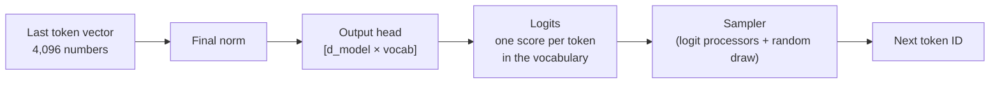

# 07 — Output Head and Sampling

**Scope:** how the last token vector becomes one chosen token, and how the runtime decides when to stop.
**Previous:** [06 MLP and neurons](06-mlp-and-neurons.md). **Next:** [08 Inference runtime](08-inference-runtime.md).

## The output head

After the last block, the runtime applies a final norm to each token vector ([04](04-transformer-block.md)). Then the **output head** (also "unembedding" or "LM head") converts the vector into scores.

The output head is a weight matrix of shape `[model dimension, vocabulary size]`. It produces one score, called a **logit**, for each vocabulary entry. For Llama 3, that is about 128,000 logits for each position.

Two system facts:

- **Generation needs only the last position.** The model computes a vector for every position, but the runtime projects only the last one through the output head. Training uses every position, because each position predicts its own next token.
- **The output head is one of the biggest matrices** when the vocabulary is large. Some models share it with the embedding table ([03](03-embeddings-and-positions.md)).

## From logits to probabilities

The softmax function converts logits into probabilities that sum to 1. A higher logit gives a higher probability.
The model's job ends here. Everything after this point is a **policy** that the runtime applies. No training is involved, and the client can change it per request.

## The sampler is a pipeline of logit processors

The runtime runs the logits through a chain of small processors, then makes one random draw. A typical chain:

| Step | Setting | What it does |
|------|---------|--------------|
| 1 | Repetition or frequency penalty | Lowers the logits of tokens that already appeared. |
| 2 | Constraint mask | Blocks tokens that would break a required format. See below. |
| 3 | Temperature | Divides all logits by a number. Below 1 sharpens the distribution. Above 1 flattens it. |
| 4 | Top-k | Keeps only the k most probable tokens. |
| 5 | Top-p (nucleus) | Keeps the smallest set of tokens whose probabilities add up to p. |
| 6 | Random draw | Picks one token from what remains, in proportion to its probability. |

The order of the steps varies between runtimes. Check the runtime's documentation ([HF generation strategies](https://huggingface.co/docs/transformers/main/en/generation_strategies)).

Other strategies:

- **Greedy:** always pick the most probable token. This is deterministic in principle. Long outputs tend to repeat.
- **Beam search:** keep several candidate sequences and choose the best whole sequence. It suits translation better than open-ended chat.

## Why not always pick the top token?

[Holtzman et al. (2020)](https://arxiv.org/abs/1904.09751) found that maximization-based methods such as beam search produce dull, repetitive text. Pure random draws pick from the "unreliable tail" of the distribution and produce incoherent text.
They proposed **nucleus (top-p) sampling**. It cuts the tail, but the size of the kept set adapts to how confident the model is.

## Constrained decoding

A runtime can force the output to follow a grammar, for example a JSON schema. At each step, it masks every token that would break the grammar.
[Willard and Louf (2023)](https://arxiv.org/abs/2307.09702) convert the grammar into a finite-state machine and pre-compute which tokens each state allows. This makes the mask cheap. Their library is Outlines.

## When generation stops

The runtime stops the loop when one of these happens:

1. The sampler picks the **end-of-sequence** special token ([01](01-tokenizer.md)).
2. The text ends with a client-defined **stop sequence**.
3. The output reaches the **maximum token** limit.
4. The context window is full.

## Determinism

Temperature 0 does not guarantee identical outputs on a production server.
Thinking Machines Lab traced the main cause to **batch variance**: a GPU kernel can split its arithmetic differently for different batch sizes, so the same prompt gives slightly different logits under different server load ([He et al., 2025](https://thinkingmachines.ai/blog/defeating-nondeterminism-in-llm-inference/)).
Batch-invariant kernels remove this effect, at some speed cost.

## Sources

- Holtzman et al., *The Curious Case of Neural Text Degeneration*, ICLR 2020 — https://arxiv.org/abs/1904.09751
- Hugging Face, *Generation strategies* — https://huggingface.co/docs/transformers/main/en/generation_strategies
- Hugging Face blog, *How to generate text* — https://huggingface.co/blog/how-to-generate
- Willard and Louf, *Efficient Guided Generation for Large Language Models*, 2023 — https://arxiv.org/abs/2307.09702
- He et al. (Thinking Machines Lab), *Defeating Nondeterminism in LLM Inference*, 2025 — https://thinkingmachines.ai/blog/defeating-nondeterminism-in-llm-inference/
