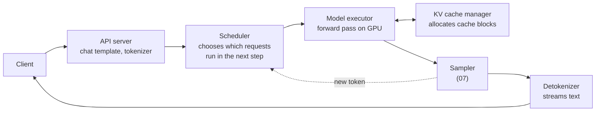
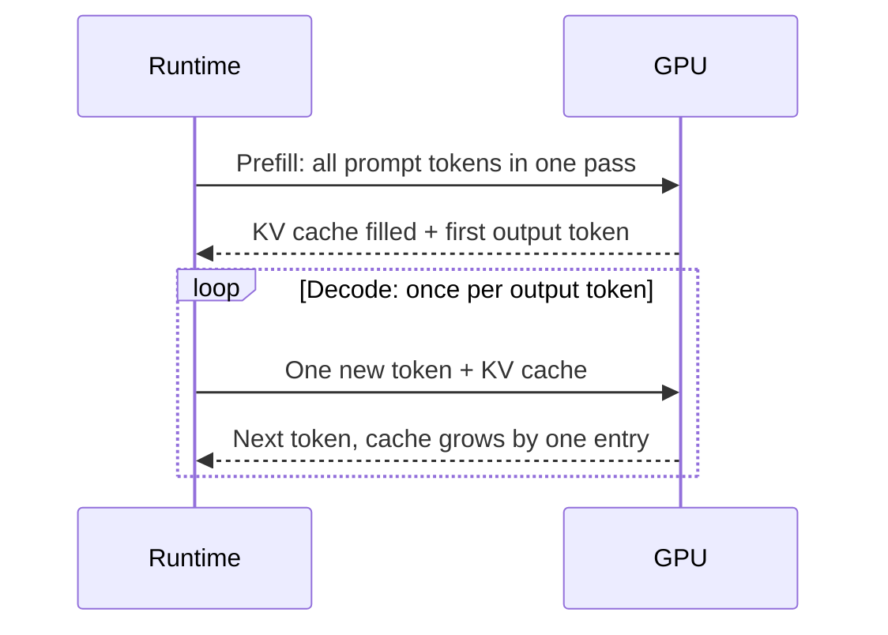

# 08 — Inference Runtime

**Scope:** how a serving system runs the model: the two phases of a request, the KV cache, batches, and the main speed techniques.
**Previous:** [07 Output and sampling](07-output-and-sampling.md). **Next:** [09 Scaling across devices](09-scaling-across-devices.md).

## Components of a serving system

Engines such as vLLM, TensorRT-LLM, and llama.cpp share a similar structure:

The scheduler and the KV cache manager are the parts that most affect speed and cost.

## Two phases: prefill and decode

Every request has two phases with very different hardware profiles ([NVIDIA, *Mastering LLM Techniques: Inference Optimization*](https://developer.nvidia.com/blog/mastering-llm-techniques-inference-optimization/)).

| | Prefill | Decode |
|---|---------|--------|
| Input per step | The whole prompt | One token per request |
| Parallel work | High: all prompt tokens at once | Low: tokens depend on each other |
| Bottleneck | **Compute** (arithmetic) | **Memory bandwidth** (data movement) |
| User-visible metric | Time to first token (TTFT) | Time per output token (TPOT), also called inter-token latency |

## Why decode is memory-bound

To produce one token, the GPU must read **every weight** from memory, plus the request's KV cache. But it does only about two arithmetic operations per weight ([02](02-tensors-and-weights.md)).
The GPU's arithmetic units are fast, so they wait for memory.

A rough estimate for one request alone:

- Llama 2 7B in bf16 has about 13.5 GB of weights.
- A data-center GPU reads memory at roughly 2 TB/s.
- So one decode step takes at least 13.5 GB ÷ 2 TB/s ≈ 7 ms. That gives at most about 150 tokens per second.

This estimate ignores the KV cache and other overhead, so real numbers are lower. It shows the key point: **for one request, speed depends on bytes moved, not on arithmetic.**

## Batches convert memory time into throughput

If the server runs 32 requests in the same step, it reads the weights once and uses them 32 times. The step takes about the same time, but it produces 32 tokens.
So batches raise throughput (total tokens per second) much more than they raise latency. This is the main economic lever of LLM serving.

The limit is memory. Each request in the batch needs its own KV cache.

## The KV cache

In each attention layer, the keys and values of earlier tokens do not change ([05](05-attention.md)). So the runtime stores them and reuses them at every decode step. This store is the **KV cache**. Some implementations keep one cache per layer ([NVIDIA](https://developer.nvidia.com/blog/mastering-llm-techniques-inference-optimization/)).

Properties:

- **It is per-request state.** It is the only state the model keeps during a request ([00](00-big-picture.md)).
- **It grows by one entry per token.** Llama 2 7B needs 512 KiB per token, so a 4,096-token context needs 2 GiB ([05](05-attention.md)).
- **It competes with the weights for GPU memory.** The free memory after the weights load sets the maximum batch size and context length.

## Continuous batching

Early systems ran a fixed batch until **all** its requests finished. A short request waited for the longest one, and new requests waited for the whole batch.
[Orca (Yu et al., OSDI 2022)](https://www.usenix.org/conference/osdi22/presentation/yu) schedules at the level of **one iteration** instead. After each decode step, finished requests leave and new requests join.
vLLM calls this "continuous batching". TensorRT-LLM calls it "in-flight batching".

## PagedAttention: virtual memory for the KV cache

Before PagedAttention, systems reserved one contiguous memory region per request, sized for the maximum length. Most of this memory went unused, through fragmentation and over-reservation.
[PagedAttention (Kwon et al., SOSP 2023)](https://arxiv.org/abs/2309.06180) applies the operating-system idea of paging:

- The cache is split into fixed-size **blocks**, like memory pages.
- A per-request **block table** maps logical token positions to physical blocks, like a page table.
- Blocks need not be contiguous, so external fragmentation disappears.
- Requests can **share** blocks, for example when several outputs come from the same prompt.

vLLM, built on PagedAttention, reported 2–4× higher throughput than earlier systems at the same latency.

## Other runtime techniques

| Technique | Problem it solves | How |
|-----------|-------------------|-----|
| **Prefix caching** | Many requests share the same system prompt | Keep the KV cache of a common prefix and reuse it. This skips part of the prefill. |
| **Chunked prefill** | A long prompt blocks decode steps of other requests | Split the prefill into chunks and mix them with decode steps ([NVIDIA](https://developer.nvidia.com/blog/streamlining-ai-inference-performance-and-deployment-with-nvidia-tensorrt-llm-chunked-prefill/)). |
| **Disaggregated serving** | Prefill and decode need different hardware profiles | Run prefill and decode on separate GPU pools and transfer the KV cache. |
| **Speculative decoding** | Decode does one token per memory-bound step | A small draft model proposes several tokens. The large model checks them all in one pass. The output distribution stays the same as the large model's ([Leviathan et al., 2023](https://arxiv.org/abs/2211.17192)). |
| **FlashAttention** | Attention memory traffic | Tile the computation in on-chip SRAM ([05](05-attention.md)). |
| **Quantization** | Weight and cache size | Store numbers in fewer bits ([11](11-model-files-and-quantization.md)). |

## Sources

- NVIDIA Technical Blog, *Mastering LLM Techniques: Inference Optimization* — https://developer.nvidia.com/blog/mastering-llm-techniques-inference-optimization/
- NVIDIA Technical Blog, *Streamlining AI Inference Performance and Deployment with NVIDIA TensorRT-LLM Chunked Prefill* — https://developer.nvidia.com/blog/streamlining-ai-inference-performance-and-deployment-with-nvidia-tensorrt-llm-chunked-prefill/
- Yu et al., *Orca: A Distributed Serving System for Transformer-Based Generative Models*, OSDI 2022 — https://www.usenix.org/conference/osdi22/presentation/yu
- Kwon et al., *Efficient Memory Management for Large Language Model Serving with PagedAttention*, SOSP 2023 — https://arxiv.org/abs/2309.06180
- Leviathan, Kalman, Matias, *Fast Inference from Transformers via Speculative Decoding*, ICML 2023 — https://arxiv.org/abs/2211.17192
- Dao et al., *FlashAttention*, NeurIPS 2022 — https://arxiv.org/abs/2205.14135
