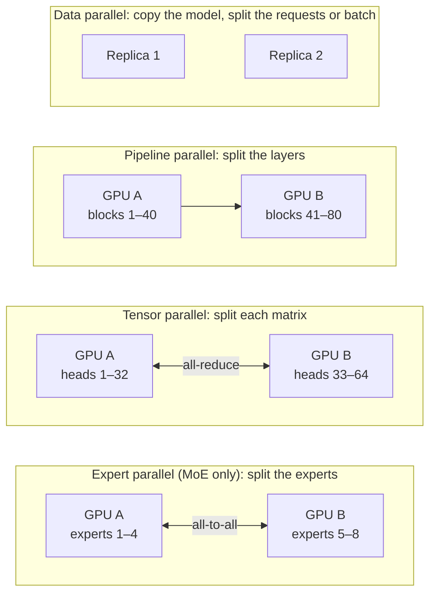

# 09 — Scaling Across Devices

**Scope:** how a model that does not fit on one GPU runs on many GPUs, for training and for inference.
**Previous:** [08 Inference runtime](08-inference-runtime.md). **Next:** [10 Mixture of experts](10-mixture-of-experts.md).

## The problem

Llama 2 70B needs about 140 GB for its weights in bf16 ([02](02-tensors-and-weights.md)). A large data-center GPU has 80 GB of memory. So the model does not fit on one GPU, even before the KV cache.
Training needs much more memory: gradients and optimizer state add about 16 bytes per parameter in total with Adam and mixed precision ([Rajbhandari et al., 2020](https://arxiv.org/abs/1910.02054)).

The fixed block structure ([04](04-transformer-block.md)) gives several natural places to split the work.

## The four main splits

| Split | What each GPU holds | Communication | Best link |
|-------|---------------------|---------------|-----------|
| **Data parallel** | A full copy of the model | Training: average the gradients once per step. Inference: none. | Any |
| **Tensor parallel** | A slice of every weight matrix | Two all-reduce operations per block, in every forward pass | Very fast (NVLink, inside one server) |
| **Pipeline parallel** | A range of whole blocks | Send the activations to the next stage | Moderate (can cross servers) |
| **Expert parallel** | A subset of the MoE experts | Send each token to its experts and back (all-to-all) | Fast |

## Tensor parallelism in detail

[Megatron-LM (Shoeybi et al., 2019)](https://arxiv.org/abs/1909.08053) splits each block across GPUs with few synchronization points:

- **Attention:** each GPU computes a subset of the heads. Heads are independent ([05](05-attention.md)), so this split needs no communication until the output projection.
- **MLP:** the first matrix splits by columns, so each GPU applies the activation function to its own slice. The second matrix splits by rows. One all-reduce sums the partial results.

The result is two all-reduce operations per block in the forward pass. Because this traffic happens in every block, tensor parallelism needs a very fast link.
The later Megatron paper reports that tensor parallelism works well inside one 8-GPU server, but degrades across servers, where the links are slower ([Narayanan et al., 2021](https://arxiv.org/abs/2104.04473)).

## Pipeline parallelism in detail

Pipeline parallelism puts consecutive blocks on consecutive GPUs, like stages of an assembly line.
With one large batch, only one stage works at a time and the others wait. These idle periods are "bubbles". So the runtime splits the batch into micro-batches that flow through the stages one after another ([GPipe, Huang et al., 2019](https://arxiv.org/abs/1811.06965)).

## Sharded data parallelism

Plain data parallelism stores a full copy of the weights, gradients, and optimizer state on every GPU. This wastes memory.
**ZeRO** ([Rajbhandari et al., 2020](https://arxiv.org/abs/1910.02054)) and PyTorch **FSDP** split these three kinds of state across the data-parallel GPUs. Each GPU collects the weights of a layer only when it needs them.

## The usual combination

Large training runs combine the splits. This is often called "3D parallelism" ([Narayanan et al., 2021](https://arxiv.org/abs/2104.04473)):

- Tensor parallel **inside** a server, over the fastest links.
- Pipeline parallel **across** servers.
- Data parallel across copies of this whole arrangement.

For inference, a common layout is tensor parallel across the GPUs of one server. Data parallel replicas then handle more traffic.

## Sources

- Shoeybi et al., *Megatron-LM: Training Multi-Billion Parameter Language Models Using Model Parallelism*, 2019 — https://arxiv.org/abs/1909.08053
- Narayanan et al., *Efficient Large-Scale Language Model Training on GPU Clusters Using Megatron-LM*, SC 2021 — https://arxiv.org/abs/2104.04473
- Huang et al., *GPipe: Efficient Training of Giant Neural Networks using Pipeline Parallelism*, NeurIPS 2019 — https://arxiv.org/abs/1811.06965
- Rajbhandari et al., *ZeRO: Memory Optimizations Toward Training Trillion Parameter Models*, SC 2020 — https://arxiv.org/abs/1910.02054
- PyTorch, *Getting Started with Fully Sharded Data Parallel (FSDP)* — https://docs.pytorch.org/tutorials/intermediate/FSDP_tutorial.html
