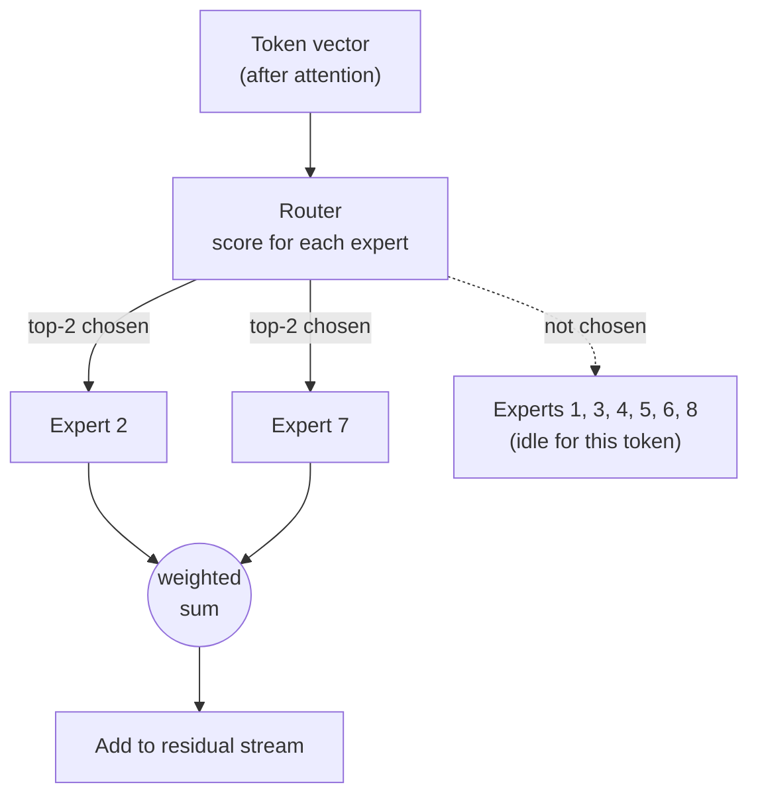

# 10 — Mixture of Experts (MoE)

**Scope:** models that keep many expert MLPs but run only a few of them for each token.
**Previous:** [09 Scaling across devices](09-scaling-across-devices.md). **Next:** [11 Model files and quantization](11-model-files-and-quantization.md).

## The idea

In a dense model, every token passes through every weight. In an MoE model, each block replaces its single MLP ([06](06-mlp-and-neurons.md)) with:

- a set of **experts**: several independent MLPs, each a normal feed-forward block, and
- a **router**: a small learned layer that picks which experts process each token.

Attention, norms, and embeddings stay the same as in a dense model.
The idea dates back to [Shazeer et al. (2017)](https://arxiv.org/abs/1701.06538). [GShard (Lepikhin et al., 2020)](https://arxiv.org/abs/2006.16668) and [Switch Transformer (Fedus et al., 2021)](https://arxiv.org/abs/2101.03961) scaled it to transformers.

## How the router works

1. The router computes a score for each expert from the token vector.
2. It keeps the **top-k** experts. Mixtral uses k = 2 ([Jiang et al., 2024](https://arxiv.org/abs/2401.04088)). Switch Transformer uses k = 1.
3. It converts the kept scores into weights.
4. The selected experts run. Their outputs combine as a weighted sum.

The router decides **per token and per layer**. One token can use different experts in different layers. Neighbor tokens can use different experts in the same layer.

## Total versus active parameters

MoE separates two numbers that are equal in a dense model:

| Model | Total parameters | Active parameters per token |
|-------|------------------|-----------------------------|
| Mixtral 8x7B | about 47 B | about 13 B |

The attention layers and embeddings are shared, so the total is less than 8 × 7 B.

The system consequence:

- **Compute per token follows the active count.** Mixtral costs about as much arithmetic per token as a 13 B dense model.
- **Memory follows the total count.** All experts must stay loaded, because the next token can need any of them. Mixtral needs the memory of a 47 B model.

So MoE trades memory for compute. It suits large servers more than small devices.

## System challenges

| Challenge | Why it happens | Common response |
|-----------|----------------|-----------------|
| **Load imbalance** | The router can send most tokens to a few favorite experts. | An auxiliary **load-balancing loss** in training pushes the router toward an even spread ([Switch Transformer](https://arxiv.org/abs/2101.03961)). |
| **Capacity overflow** | Each expert has a fixed buffer per batch. | A **capacity factor** sets the buffer size. Switch Transformer drops tokens beyond the buffer from that layer's expert step. |
| **Communication** | With expert parallelism, experts live on different GPUs ([09](09-scaling-across-devices.md)). | An **all-to-all** exchange sends each token to its experts and back, in every MoE layer. |
| **Memory bandwidth in large batches** | Different tokens in a batch select different experts. So a large decode batch reads most experts in every step. | Expert parallelism and batch scheduling. |

## What experts specialize in

The name "expert" suggests topic experts, such as a "math expert". The evidence does not support this simple picture.
The Mixtral authors analyzed the router choices and report no clear pattern by topic. They saw more structure tied to syntax and to token position ([Jiang et al., 2024](https://arxiv.org/abs/2401.04088)).
Treat an expert as a capacity unit that the router learned to use, not as a human-readable module.

## Sources

- Shazeer et al., *Outrageously Large Neural Networks: The Sparsely-Gated Mixture-of-Experts Layer*, ICLR 2017 — https://arxiv.org/abs/1701.06538
- Lepikhin et al., *GShard: Scaling Giant Models with Conditional Computation and Automatic Sharding*, 2020 — https://arxiv.org/abs/2006.16668
- Fedus, Zoph, Shazeer, *Switch Transformers: Scaling to Trillion Parameter Models with Simple and Efficient Sparsity*, JMLR 2022 — https://arxiv.org/abs/2101.03961
- Jiang et al., *Mixtral of Experts*, 2024 — https://arxiv.org/abs/2401.04088
