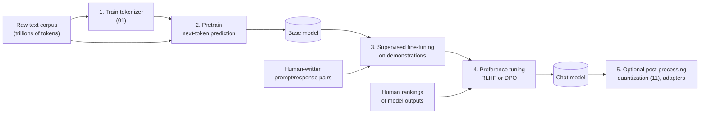

# 12 — Training Lifecycle

**Scope:** the pipeline that produces the weights file, seen as a sequence of system stages. This document skips the math of the gradient.
**Previous:** [11 Model files and quantization](11-model-files-and-quantization.md). **Next:** [13 Interpretability](13-interpretability.md).

## The weights file is a build artifact

The weights ([02](02-tensors-and-weights.md)) are the output of a multi-stage pipeline. Each stage keeps the architecture and changes only the numbers. The `config.json` file stays the same from the first stage to the last.

## Stage 1: train the tokenizer

The tokenizer trains first, on a sample of the corpus, and then stays frozen ([01](01-tokenizer.md)). Its vocabulary size fixes the shape of the embedding table and the output head.

## Stage 2: pretraining

The model learns to predict the next token on a very large text corpus.

**The training step** repeats millions of times:

1. **Forward pass.** Run a batch of text through the model. This is the same computation as inference ([00](00-big-picture.md)), but every position predicts its own next token at once.
2. **Loss.** Measure how much probability the model gave to the real next tokens.
3. **Backward pass.** Compute, for every weight, the direction that reduces the loss (the gradient).
4. **Optimizer update.** Move every weight a small step in that direction.

**System profile:**

- Training holds much more state than inference. With the Adam optimizer and mixed precision, each parameter needs about 16 bytes for weights, gradients, and optimizer state ([Rajbhandari et al., 2020](https://arxiv.org/abs/1910.02054)). The activations of the forward pass must also stay in memory for the backward pass.
- So training needs data, tensor, and pipeline parallelism across thousands of GPUs ([09](09-scaling-across-devices.md)).

**How much data?** [Hoffmann et al. (2022), "Chinchilla"](https://arxiv.org/abs/2203.15556) found that, for a fixed compute budget, the model size and the data size should grow together. The popular summary is about 20 training tokens per parameter.
That rule optimizes **training** cost only. A smaller model is cheaper to **serve**. So labs now train small models on far more data. Llama 3 8B trained on about 15 trillion tokens, far beyond the Chinchilla ratio ([Llama 3 paper](https://arxiv.org/abs/2407.21783)).

The output of this stage is a **base model**. It continues text well, but it does not follow instructions reliably.

## Stage 3: supervised fine-tuning (SFT)

The base model trains further on a smaller set of example conversations. People write ideal responses to prompts.
This stage teaches the response style and the **chat template** format ([01](01-tokenizer.md)). The training step is the same as in pretraining. Only the data changes.

## Stage 4: preference tuning

People compare pairs of model outputs and choose the better one. The model then trains to prefer the outputs that people prefer.

**RLHF**, as described in InstructGPT ([Ouyang et al., 2022](https://arxiv.org/abs/2203.02155)), has three steps:

1. Supervised fine-tuning on demonstrations (stage 3).
2. Train a separate **reward model** on human rankings. It learns to predict which output a person would prefer.
3. Fine-tune the language model with reinforcement learning (PPO) to raise the reward model's score.

In human evaluations, outputs of the 1.3 B-parameter InstructGPT model were preferred to outputs of the 175 B-parameter GPT-3. For human preference, the post-training stages mattered more than a 100× difference in size.

**DPO** ([Rafailov et al., 2023](https://arxiv.org/abs/2305.18290)) removes the separate reward model and the reinforcement learning loop. It trains directly on the preference pairs. This makes the pipeline simpler.

## Stage 5: optional post-processing

- **Quantization** shrinks the model for serving ([11](11-model-files-and-quantization.md)).
- **LoRA adapters** ([Hu et al., 2021](https://arxiv.org/abs/2106.09685)) fine-tune a model by training small add-on matrices and freezing the original weights. An adapter file is often only megabytes in size. A server can load one base model and switch between many adapters.

## Sources

- Hoffmann et al., *Training Compute-Optimal Large Language Models (Chinchilla)*, 2022 — https://arxiv.org/abs/2203.15556
- Kaplan et al., *Scaling Laws for Neural Language Models*, 2020 — https://arxiv.org/abs/2001.08361
- Ouyang et al., *Training language models to follow instructions with human feedback (InstructGPT)*, NeurIPS 2022 — https://arxiv.org/abs/2203.02155
- Rafailov et al., *Direct Preference Optimization*, NeurIPS 2023 — https://arxiv.org/abs/2305.18290
- Hu et al., *LoRA: Low-Rank Adaptation of Large Language Models*, ICLR 2022 — https://arxiv.org/abs/2106.09685
- Rajbhandari et al., *ZeRO*, SC 2020 — https://arxiv.org/abs/1910.02054
- Llama Team, *The Llama 3 Herd of Models*, 2024 — https://arxiv.org/abs/2407.21783
