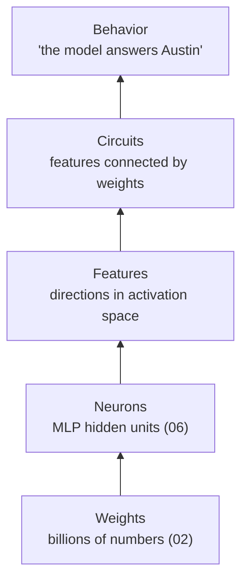

# 13 — Interpretability: Features and Circuits

**Scope:** what researchers find when they look inside an LLM: features, superposition, and circuits. This is the "debugger" view of the model.
**Previous:** [12 Training lifecycle](12-training-lifecycle.md). **Next:** [14 Reasoning models](14-reasoning-models.md).

## Why a system designer should care

The weights file has no comments and no symbol table. Interpretability research tries to recover the "source code" of the behavior from the weights.
It matters for the same reasons a debugger matters: to explain a failure, to verify a safety property, and to change a behavior on purpose.

## Levels of description

The neuron is the unit that the architecture defines. The **feature** is the unit that carries meaning. The research below explains why the two differ.

## Features are directions, not neurons

[Olah et al. (2020), *Zoom In*](https://distill.pub/2020/circuits/zoom-in/) propose three claims from work on vision models:

1. **Features** are the basic units of a network. A feature corresponds to a **direction** in the space of activations.
2. Features connect through weights to form **circuits**.
3. Similar features and circuits appear in different models ("universality").

A direction can align with one neuron, but it does not have to. In LLMs, it usually does not.

## Superposition: more features than dimensions

[Elhage et al. (2022), *Toy Models of Superposition*](https://transformer-circuits.pub/2022/toy_model/index.html) explain why neurons are rarely clean:

- A model must represent more features than it has dimensions.
- Most features are **sparse**: they are active for only a few inputs. Two rare features seldom appear together.
- So the model can store several features in overlapping directions, with small interference. This is **superposition**.
- The consequence is the **polysemantic neuron**: one neuron responds to several unrelated features.

A system analogy: the residual stream ([04](04-transformer-block.md)) is a fixed-width bus, and the model compresses a much larger set of signals onto it. The signals are recoverable only because few are active at once.

## Sparse autoencoders: a decoder for superposition

A **sparse autoencoder** (SAE) is a separate, small network trained to "unzip" activations into features:

- **Encoder:** it maps an activation vector into a much larger set of feature activations, most of them zero.
- **Decoder:** it rebuilds the original activation from the active features.
- Training rewards both an accurate rebuild and few active features.

Key results from Anthropic:

- [Bricken et al. (2023), *Towards Monosemanticity*](https://transformer-circuits.pub/2023/monosemantic-features/index.html) applied SAEs to a one-layer transformer and found features far more interpretable than its neurons.
- [Templeton et al. (2024), *Scaling Monosemanticity*](https://transformer-circuits.pub/2024/scaling-monosemanticity/index.html) trained SAEs with up to 34 million features on the middle-layer residual stream of Claude 3 Sonnet. The features were multilingual and multimodal. They covered concrete entities and abstract concepts, including safety-relevant ones such as deception and sycophancy.
- Features can **steer** behavior. When researchers forced a "Golden Gate Bridge" feature to stay active, the model brought the bridge into unrelated answers ([*Golden Gate Claude*](https://www.anthropic.com/news/golden-gate-claude)).

A caution from critics: a feature's label comes from its strongest examples. The feature can also be active in many weaker cases that do not fit the label.

## Circuits: how features connect

A circuit is a sub-graph of the model that implements one behavior.

- **Induction heads** ([Olsson et al., 2022](https://transformer-circuits.pub/2022/in-context-learning-and-induction-heads/index.html)) are a two-layer attention circuit that copies patterns from earlier in the context. See [05](05-attention.md).
- **Factual recall** runs through mid-layer MLPs ([Meng et al., 2022](https://arxiv.org/abs/2202.05262)). See [06](06-mlp-and-neurons.md).
- **Attribution graphs** ([Ameisen et al., 2025](https://transformer-circuits.pub/2025/attribution-graphs/methods.html); [Lindsey et al., 2025](https://transformer-circuits.pub/2025/attribution-graphs/biology.html)) replace the model's MLPs with an interpretable stand-in ("cross-layer transcoder"). Then they trace which features cause which, for one prompt. Findings on Claude 3.5 Haiku include:
  - **Multi-step reasoning:** for "the capital of the state that contains Dallas", the model represents "Texas" internally before it outputs "Austin".
  - **Planning ahead:** for rhyming poetry, the model often selects the rhyme word before it writes the line that leads to it.

The authors note limits: the method gives useful insight on only a fraction of prompts, and each graph explains one prompt, not the general mechanism.

## Toolkit summary

| Method | Question it answers | Cost |
|--------|---------------------|------|
| Neuron inspection | What makes this unit fire? | Low, but polysemanticity limits it |
| Activation patching / causal tracing | Which component is necessary for this output? | One extra forward pass per test |
| Sparse autoencoder | What features are present at this layer? | High: train a large extra network per layer |
| Feature steering | What happens if this feature is forced on or off? | Low, after the SAE exists |
| Attribution graph | Which chain of features produced this output? | High: a replacement model plus manual analysis per prompt |

## Sources

- Olah et al., *Zoom In: An Introduction to Circuits*, Distill, 2020 — https://distill.pub/2020/circuits/zoom-in/
- Elhage et al., *A Mathematical Framework for Transformer Circuits*, Anthropic, 2021 — https://transformer-circuits.pub/2021/framework/index.html
- Elhage et al., *Toy Models of Superposition*, Anthropic, 2022 — https://transformer-circuits.pub/2022/toy_model/index.html
- Olsson et al., *In-context Learning and Induction Heads*, Anthropic, 2022 — https://transformer-circuits.pub/2022/in-context-learning-and-induction-heads/index.html
- Bricken et al., *Towards Monosemanticity*, Anthropic, 2023 — https://transformer-circuits.pub/2023/monosemantic-features/index.html
- Templeton et al., *Scaling Monosemanticity*, Anthropic, 2024 — https://transformer-circuits.pub/2024/scaling-monosemanticity/index.html
- Anthropic, *Golden Gate Claude*, 2024 — https://www.anthropic.com/news/golden-gate-claude
- Ameisen et al., *Circuit Tracing: Revealing Computational Graphs in Language Models*, Anthropic, 2025 — https://transformer-circuits.pub/2025/attribution-graphs/methods.html
- Lindsey et al., *On the Biology of a Large Language Model*, Anthropic, 2025 — https://transformer-circuits.pub/2025/attribution-graphs/biology.html
- Meng et al., *Locating and Editing Factual Associations in GPT*, NeurIPS 2022 — https://arxiv.org/abs/2202.05262
