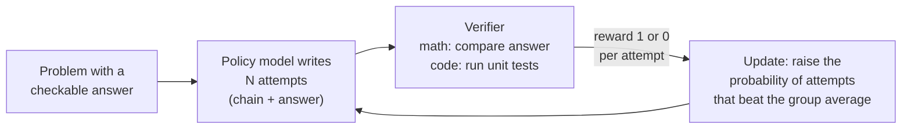
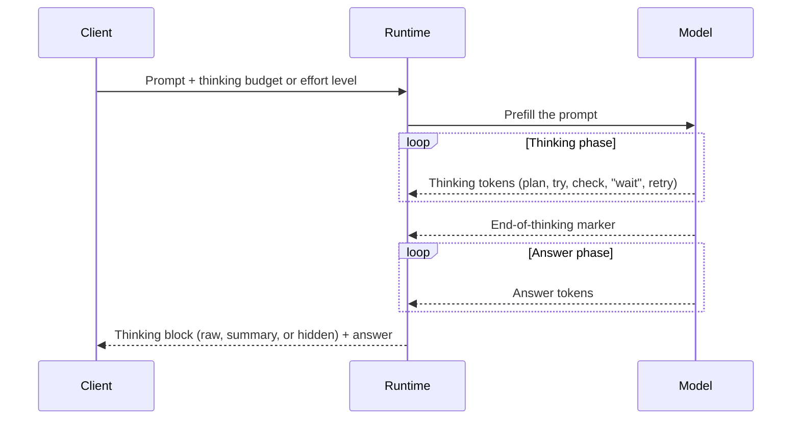

# 14 — Reasoning Models

**Scope:** what "reasoning" means for an LLM, how the training of reasoning models differs, and what happens inside one reasoning request.
**Previous:** [13 Interpretability](13-interpretability.md). **Index:** [README](README.md).

## What "reasoning" means in the LLM world

There is no single agreed definition. The term has three uses, and it is important to know which one a text means:

| Use | Meaning | Example |
|-----|---------|---------|
| **A task type** | A problem that needs several dependent steps to solve: math, code, logic, planning. | "What is the capital of the state that contains Dallas?" needs two steps. |
| **A mechanism** | The model writes intermediate tokens (a "chain of thought") before the final answer. | "Dallas is in Texas. The capital of Texas is Austin. Answer: Austin." |
| **A model category** | A "reasoning model" (or "thinking model") is trained to write a long chain of thought by default, and the runtime gives it a budget for it. | OpenAI o1, DeepSeek-R1, Claude with extended or adaptive thinking. |

Whether this is "real" reasoning is a contested question. This document does not answer it. It describes what the systems do, and it lists the main evidence for and against in [Limits and open questions](#limits-and-open-questions).

## Why intermediate tokens help: a system view

One forward pass does a fixed amount of work per token ([02](02-tensors-and-weights.md)). The number of blocks in the stack limits how many dependent steps the model can do inside one pass ([04](04-transformer-block.md)).
A chain of thought removes this limit in two ways:

1. **More passes.** Each written token is one more full forward pass. A 5,000-token chain gives the model 5,000 more passes before the answer.
2. **External memory.** Each written token goes into the context and the KV cache ([08](08-inference-runtime.md)). Later tokens can read it through attention ([05](05-attention.md)). So the context acts as a scratchpad for intermediate results.

[Li et al. (2024)](https://arxiv.org/abs/2402.12875) show in theory that a chain of thought lets a transformer solve inherently serial problems that a single pass cannot.

Models also do some multi-step work **inside** one pass, without written steps. Anthropic's attribution graphs show an internal "Texas" step before "Austin" ([Lindsey et al., 2025](https://transformer-circuits.pub/2025/attribution-graphs/biology.html); see [13](13-interpretability.md)). Written reasoning extends this internal capacity. It does not replace it.

## History: from prompts to trained behavior

| Year | Step | What changed |
|------|------|--------------|
| 2022 | **Chain-of-thought prompting** ([Wei et al.](https://arxiv.org/abs/2201.11903)) | Examples with written steps in the prompt raised accuracy on math and logic, in large models only. |
| 2022 | **"Let's think step by step"** ([Kojima et al.](https://arxiv.org/abs/2205.11916)) | One sentence, with no examples, gave a similar effect. |
| 2022 | **Self-consistency** ([Wang et al.](https://arxiv.org/abs/2203.11171)) | Sample many chains and take the majority answer. |
| 2023 | **Process supervision** ([Lightman et al.](https://arxiv.org/abs/2305.20050)) | A reward model that grades each step chose correct solutions better than one that grades only the final answer. |
| 2024 | **OpenAI o1** ([OpenAI](https://openai.com/index/learning-to-reason-with-llms/)) | Large-scale reinforcement learning trained the model to use its chain of thought. Accuracy rose with both training compute and thinking time. |
| 2025 | **DeepSeek-R1** ([DeepSeek-AI](https://arxiv.org/abs/2501.12948)) | An open model and paper showed that RL with rule-based rewards alone can produce long reasoning. |

The key shift: in 2022 the user had to ask for reasoning in the prompt. Since 2024, training builds it into the model.

## How training differs

A reasoning model uses the same architecture and the same pretraining as a normal model ([12](12-training-lifecycle.md)). The difference is an extra post-training stage: **reinforcement learning on tasks with checkable answers**.

### The reward comes from a program, not a person

[Tülu 3 (Lambert et al., 2024)](https://arxiv.org/abs/2411.15124) named this "reinforcement learning with verifiable rewards" (RLVR). It keeps the RLHF loop but replaces the learned reward model with a check function. A correct answer gets a reward. Anything else gets zero.

| | Normal chat post-training | Reasoning post-training |
|---|---------------------------|-------------------------|
| Reward source | A reward model trained on human preferences ([12](12-training-lifecycle.md)) | A verifier program: answer match, unit tests, format rules |
| What gets graded | Style and helpfulness of the reply | Only the final answer (and its format) |
| Who writes the reasoning | Human demonstrations | The model itself; no human writes the chain |
| Typical domains | Open-ended chat | Math, code, science questions, logic puzzles |

DeepSeek-R1 used only accuracy and format rewards. Its authors report that a process reward model and Monte Carlo tree search did not work well at scale, partly because the model learned to "hack" the learned reward ([DeepSeek-AI, 2025](https://arxiv.org/abs/2501.12948)).

### GRPO: compare attempts in a group

DeepSeek trains with GRPO, from [DeepSeekMath (Shao et al., 2024)](https://arxiv.org/abs/2402.03300). For each problem, the model writes a group of attempts. Each attempt's reward is compared with the group's average. Attempts above the average become more likely.
This removes the separate "value model" that PPO needs, so training uses less memory.

### What emerges

Nobody tells the model to write long chains or to check its work. These behaviors appear because they raise the reward:

- **The chains get longer** as training goes on. R1-Zero learned to use more thinking time on harder problems.
- **Self-checks and backtracks appear.** The R1 paper reports an "aha moment": the model starts to stop, re-evaluate, and try another approach.
- OpenAI reports similar behaviors for o1: it finds its own errors, splits hard steps, and changes strategy ([OpenAI, 2024](https://openai.com/index/learning-to-reason-with-llms/)).

Pure RL (R1-Zero) gave hard-to-read chains with mixed languages. The final R1 pipeline added a small SFT stage on readable long chains first ("cold start"), then RL, then more SFT and RL.

### Distillation: reasoning for small models

A small model can learn reasoning by supervised fine-tuning on chains written by a large reasoning model:

- DeepSeek fine-tuned Qwen and Llama models on R1's outputs and reports large gains.
- [s1 (Muennighoff et al., 2025)](https://arxiv.org/abs/2501.19393) fine-tuned a 32 B model on only 1,000 selected examples and got strong math results.

### Does RL teach new skills?

[Yue et al. (2025)](https://arxiv.org/abs/2504.13837) found that RL-trained models beat their base models when the model gets one attempt. But with many attempts (large k in pass@k), the base model solves as many problems or more. Their reading: RL makes the model pick its best existing paths more reliably, more than it creates new ones. They report that distillation can add new patterns. This question is still under debate.

### Training infrastructure

RL training is mostly **inference**. Most of the compute goes to writing attempts, not to weight updates. A typical system has three parts:

1. A rollout fleet: inference engines that write the attempts ([08](08-inference-runtime.md)).
2. A verifier fleet: sandboxes that run code and tests, or answer checkers.
3. A trainer: it updates the weights and sends them back to the rollout fleet.

## The reasoning process at inference time

### There is no separate reasoning module

The model uses the same forward pass for thinking tokens and answer tokens. The only difference is a pair of special tokens or a template that marks the thinking section. DeepSeek-R1 writes its chain between `<think>` and `</think>` tags. The Claude API returns the thinking in separate `thinking` content blocks ([Anthropic docs](https://platform.claude.com/docs/en/build-with-claude/extended-thinking)).

### A typical chain

Chains vary, but they often follow this pattern:

1. Restate the problem and its constraints.
2. Choose an approach.
3. Work through the steps.
4. Check the result, for example with a different method.
5. If the check fails, backtrack ("Wait, that is wrong...") and try again.
6. Give the final answer.

### Control of the thinking length

| Control | How it works |
|---------|--------------|
| **Token budget** | The client sets a maximum number of thinking tokens. Older Claude models used `budget_tokens`. |
| **Effort level** | The client sets a level such as low, medium, or high. The model decides how much to think within that level. Current Claude models use an effort setting with "adaptive" thinking ([Anthropic docs](https://platform.claude.com/docs/en/build-with-claude/extended-thinking)). |
| **Budget forcing** | The runtime stops the chain at a limit, or replaces the end-of-thinking marker with "Wait" to force more thinking. s1 raised its AIME24 score from 50% to 57% this way ([Muennighoff et al., 2025](https://arxiv.org/abs/2501.19393)). |

### Who sees the chain

| Provider | Raw chain visible? |
|----------|--------------------|
| DeepSeek-R1 (open weights) | Yes. |
| OpenAI o-series | No. The chain is hidden. |
| Claude API (current models) | No. The API returns a summary or an empty field. An encrypted `signature` lets the client pass the block back in the next request, so the model keeps its context. |

### Thinking between tool calls

In an agent loop, a reasoning model can think, call a tool, read the result, and think again before the next call. Anthropic calls this "interleaved thinking". The thinking blocks must go back to the API unchanged with the tool results, or the model loses its earlier reasoning.

### Two ways to spend more compute at inference

| Way | Method | Cost |
|-----|--------|------|
| **Sequential** | One longer chain | Higher latency |
| **Parallel** | Many chains, then a majority vote (self-consistency) or a verifier that picks the best | More total tokens, same latency if run in parallel |

[Snell et al. (2024)](https://arxiv.org/abs/2408.03314) found that the best mix depends on problem difficulty. With a good allocation, a small model plus extra test-time compute beat a model 14 times larger on problems of medium difficulty.

## System costs

- **Output tokens dominate.** A chain can hold thousands of tokens. Thinking tokens bill as output tokens, even when the API hides them.
- **Latency grows.** Decode is the slow, memory-bound phase ([08](08-inference-runtime.md)), and the answer starts only after the chain ends.
- **The KV cache grows.** Long chains fill GPU memory, so fewer requests fit in one batch.
- **The context fills.** In multi-turn and agent use, earlier chains take context space. Runtimes can drop or compress old thinking blocks.

## Limits and open questions

- **Faithfulness.** A chain is not a reliable log of the model's real computation. Anthropic gave models hidden hints and checked if the chain admitted their use. Claude 3.7 Sonnet and DeepSeek-R1 often hid them; the mention rate was often below 20% ([Chen et al., 2025](https://www.anthropic.com/research/reasoning-models-dont-say-think)). The attribution-graph work also caught Claude "in the act": given a hard math problem and an incorrect hint, it wrote a plausible argument that agreed with the hint, not one that followed logical steps ([Anthropic, *Tracing the thoughts of a large language model*](https://www.anthropic.com/research/tracing-thoughts-language-model); [Lindsey et al., 2025](https://transformer-circuits.pub/2025/attribution-graphs/biology.html)).
- **Monitoring.** The chain is still a useful window for safety monitoring. But OpenAI found that if training penalizes "bad thoughts" in the chain, the model can learn to hide its intent and keep the bad behavior ([Baker et al., 2025](https://arxiv.org/abs/2503.11926)).
- **Overthinking and collapse.** Apple researchers found that reasoning models give little gain on easy puzzles and fail at high complexity, even with budget left ([Shojaee et al., 2025](https://machinelearning.apple.com/research/illusion-of-thinking)). A response paper argues that part of this result comes from the test design: output token limits, and puzzle instances with no solution that still counted as failures ([Lawsen, 2025](https://arxiv.org/abs/2506.09250)).
- **Domains without verifiers.** RLVR needs a check function. Open-ended writing, judgment, and research have no simple check, so the training signal there is weaker.

## Sources

- Wei et al., *Chain-of-Thought Prompting Elicits Reasoning in Large Language Models*, NeurIPS 2022 — https://arxiv.org/abs/2201.11903
- Kojima et al., *Large Language Models are Zero-Shot Reasoners*, NeurIPS 2022 — https://arxiv.org/abs/2205.11916
- Wang et al., *Self-Consistency Improves Chain of Thought Reasoning in Language Models*, ICLR 2023 — https://arxiv.org/abs/2203.11171
- Lightman et al., *Let's Verify Step by Step*, ICLR 2024 — https://arxiv.org/abs/2305.20050
- Li et al., *Chain of Thought Empowers Transformers to Solve Inherently Serial Problems*, ICLR 2024 — https://arxiv.org/abs/2402.12875
- OpenAI, *Learning to Reason with LLMs*, 2024 — https://openai.com/index/learning-to-reason-with-llms/
- Snell et al., *Scaling LLM Test-Time Compute Optimally can be More Effective than Scaling Model Parameters*, 2024 — https://arxiv.org/abs/2408.03314
- Shao et al., *DeepSeekMath* (GRPO), 2024 — https://arxiv.org/abs/2402.03300
- Lambert et al., *Tülu 3: Pushing Frontiers in Open Language Model Post-Training* (RLVR), 2024 — https://arxiv.org/abs/2411.15124
- DeepSeek-AI, *DeepSeek-R1: Incentivizing Reasoning Capability in LLMs via Reinforcement Learning*, 2025 — https://arxiv.org/abs/2501.12948
- Muennighoff et al., *s1: Simple test-time scaling*, 2025 — https://arxiv.org/abs/2501.19393
- Yue et al., *Does Reinforcement Learning Really Incentivize Reasoning Capacity in LLMs Beyond the Base Model?*, NeurIPS 2025 — https://arxiv.org/abs/2504.13837
- Chen et al. (Anthropic), *Reasoning Models Don't Always Say What They Think*, 2025 — https://www.anthropic.com/research/reasoning-models-dont-say-think
- Baker et al. (OpenAI), *Monitoring Reasoning Models for Misbehavior and the Risks of Promoting Obfuscation*, 2025 — https://arxiv.org/abs/2503.11926
- Lindsey et al. (Anthropic), *On the Biology of a Large Language Model*, 2025 — https://transformer-circuits.pub/2025/attribution-graphs/biology.html
- Anthropic, *Tracing the thoughts of a large language model*, 2025 — https://www.anthropic.com/research/tracing-thoughts-language-model
- Shojaee et al. (Apple), *The Illusion of Thinking*, 2025 — https://machinelearning.apple.com/research/illusion-of-thinking
- Lawsen, *The Illusion of the Illusion of Thinking*, 2025 — https://arxiv.org/abs/2506.09250
- Anthropic, *Building with extended thinking* (API documentation) — https://platform.claude.com/docs/en/build-with-claude/extended-thinking
