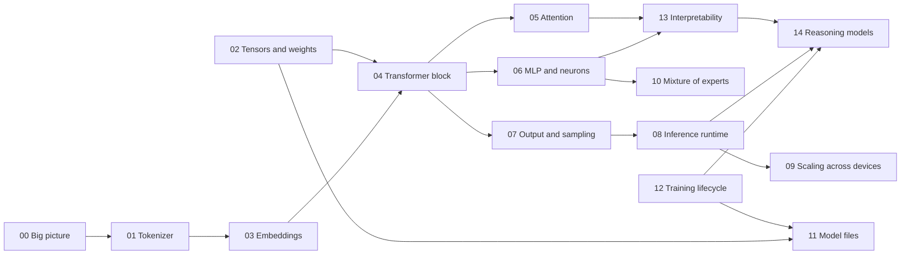

# LLM Internals — A System Architecture View

This branch collects research on the inner components of a large language model (LLM).
The documents explain each component as a part of a system: what it receives, what it produces, what state it keeps, and what it costs.
The documents avoid the math. When a formula matters, the documents describe its effect, not its derivation.

## Scope

- **In scope:** decoder-only transformer LLMs (the GPT, Llama, Mistral, and Claude family of designs), from text input to text output, plus the runtime that serves them.
- **Out of scope:** the math of backpropagation, image and audio models, and product-level topics such as prompt design.

## Reading order

Read the documents in number order for a full walk through the request path. Each document also stands alone.

| # | Document | Question it answers |
|---|----------|---------------------|
| 00 | [The big picture](00-big-picture.md) | What are the parts of an LLM, and how does a request flow through them? |
| 01 | [Tokenizer](01-tokenizer.md) | How does text become a list of integers? |
| 02 | [Tensors and weights](02-tensors-and-weights.md) | What data structure holds the model, and how big is it? |
| 03 | [Embeddings and positions](03-embeddings-and-positions.md) | How does a token ID become a vector, and how does the model know word order? |
| 04 | [Transformer block and residual stream](04-transformer-block.md) | What is the repeated unit, and how do its parts communicate? |
| 05 | [Attention](05-attention.md) | How does one token get information from other tokens? |
| 06 | [MLP layers and neurons](06-mlp-and-neurons.md) | What is a "neuron" in an LLM, and where does the model store facts? |
| 07 | [Output head and sampling](07-output-and-sampling.md) | How does a vector become the next token? |
| 08 | [Inference runtime](08-inference-runtime.md) | How does a server run the model fast: prefill, decode, KV cache, batches? |
| 09 | [Scaling across devices](09-scaling-across-devices.md) | How does a model that is too big for one GPU run on many? |
| 10 | [Mixture of experts](10-mixture-of-experts.md) | How do some models use only part of their weights for each token? |
| 11 | [Model files and quantization](11-model-files-and-quantization.md) | What is on disk, and how do smaller number formats shrink it? |
| 12 | [Training lifecycle](12-training-lifecycle.md) | Where do the weights come from? |
| 13 | [Interpretability: features and circuits](13-interpretability.md) | What do researchers find when they look inside? |
| 14 | [Reasoning models](14-reasoning-models.md) | What is "reasoning" in an LLM, how are reasoning models trained, and what happens in one thinking request? |

Support documents:

- [Glossary](glossary.md) — one-line definitions for every term in this set.
- [Sources](sources.md) — the reference list, with a trust tier for each source.
- [Anatomy of an LLM process](https://claude.ai/artifact/TvETLLNWN1Xtuk8jewHo41) — a diagram of one serving process: startup, threads, memory allocation, and the path of one user request. It expands on [08 Inference runtime](08-inference-runtime.md).
- [Life of a Token](simulation/README.md) — an interactive simulation of one chat request in a small, real transformer that runs in the browser. It follows each token from the chat template to the stop token, and it covers documents 00 to 08. Open [simulation/index.html](simulation/index.html) locally, or the [published copy](https://claude.ai/artifact/SNkcMEnHkSyWGwzeXLxBQp).

## How the documents connect

## Method

The research used primary papers, official documentation, and well-known teaching material by recognized authors.
[sources.md](sources.md) lists each source, its trust tier, and the claims it supports.
The research date is 2026-10-08.
The simulation was added on 2026-10-21. [sources.md](sources.md) logs the web searches for it.
